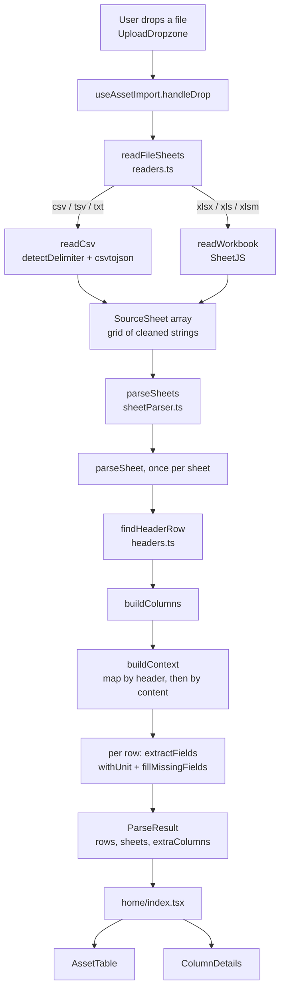

# AssetLens parser: how the business logic works

This document explains what happens from the moment a spreadsheet is dropped on the page until the extracted assets and the column details appear on screen. It covers the components that are called, what every helper returns, how the header row is found, and how columns are mapped to the eight asset fields.

All parser code lives in `src/utils/assetParser/`. It has no React or UI code and runs entirely in the browser. Nothing is uploaded to a server.

---

## 1. What the product does

Given an `.xlsx`, `.xls`, `.xlsm`, `.csv` or `.tsv` file with any layout, the parser extracts these eight fields for every asset row:

| Field key | Label |
|---|---|
| `assetType` | Asset type |
| `manufacturer` | Manufacturer |
| `model` | Model |
| `serialNumber` | Serial number |
| `cpu` | CPU |
| `ram` | RAM |
| `storage` | Storage |
| `screenSize` | Screen size |

Every other column in the file is kept as an "extra" column, so no data is lost. The parser has to cope with files where:

- there are title or banner rows above the table
- the table does not start in column A
- column names differ (`Make`, `Brand`, `Vendor`) or are missing
- columns appear in any order
- details are only available inside a free-text description
- a workbook contains several sheets
- a CSV uses `,` `;` tab or `|` as the delimiter

---

## 2. End-to-end flow



### Step by step

| # | Where | What happens |
|---|---|---|
| 1 | `UploadDropzone.tsx` | Mantine `Dropzone` accepts `.csv`, `.tsv`, `.xls`, `.xlsx`, `.xlsm` up to 20 MB. A valid file calls `onDrop`; an invalid one calls `onReject`. |
| 2 | `useAssetImport.ts` | `handleDrop` takes the first file, sets `loading`, clears the error, then runs the parser. |
| 3 | `readers.ts` | `readFileSheets(file)` turns the file into `SourceSheet[]`. |
| 4 | `sheetParser.ts` | `parseSheets(sheets)` parses each sheet in a `try/catch` and returns one `ParseResult`. |
| 5 | `useAssetImport.ts` | The hook stores `fileName` and `result`. It sets an error if `result.rows` is empty, or if reading threw. |
| 6 | `home/index.tsx` | When `result.rows.length > 0` it renders `AssetTable` and one `ColumnDetails` per sheet. |

---

## 3. Components involved when a file is uploaded or replaced

Uploading a second file simply runs the same flow again. `result` and `fileName` are replaced and the table and column details re-render with the new data.

| Component or hook | File | Role |
|---|---|---|
| `HomePage` | `src/pages/home/HomePage.tsx` | Lazy-loads the home screen and shows `HomeSkeleton` while it loads. |
| `HomeIndex` | `src/components/home/index.tsx` | Owns the page layout. Calls `useAssetImport()` and passes results down. |
| `useAssetImport` | `src/components/home/useAssetImport.ts` | The only place that calls the parser. Holds `loading`, `error`, `fileName`, `result`. |
| `UploadDropzone` | `src/components/home/UploadDropzone.tsx` | File picker and drag-and-drop area. Enforces type and size. |
| `AssetTable` | `src/components/home/AssetTable.tsx` | Search, sort, pagination and the data table. |
| `assetTable.helpers.ts` | `src/components/home/` | `buildRecords`, `filterRecords`, `sortRecords`, `extraKey`, page size constants. |
| `ColumnDetails` | `src/components/home/ColumnDetails.tsx` | Per sheet: header row number, how each column was mapped, field coverage. |
| `columnDetails.helpers.ts` | `src/components/home/` | `buildCoverage`, `fieldLabel`, `METHOD_META`. |
| `HeroSection`, `HowItWorks`, `Highlights` | `src/components/home/` | Static content. `HeroSection` reads `ASSET_FIELDS` for its badges. |

The UI only imports from `@/utils/assetParser` (the `index.ts` barrel). It never touches the internal files directly.

### Behaviour of `useAssetImport`

| Situation | State after |
|---|---|
| Valid file with asset rows | `result` set, `error` null, table shown. |
| Valid file, no rows recognised | `result` set, error "No asset rows could be recognised in this file.", table hidden. |
| Reading threw (corrupt file) | `result` cleared, error "This file could not be read...". |
| Dropzone rejected the file (type or size) | Only `error` changes. The previous table stays. |

---

## 4. File map of `src/utils/assetParser/`

| File | Responsibility |
|---|---|
| `index.ts` | Public API: `ASSET_FIELDS`, types, `parseSheets`, `readFileSheets`. |
| `types.ts` | All shared types and the `ASSET_FIELDS` list. |
| `text.ts` | Small string and number helpers. |
| `patterns.ts` | Every alias list and regular expression. The only place to tune vocabulary. |
| `readers.ts` | File to `SourceSheet[]`. CSV delimiter detection and Excel reading. |
| `headers.ts` | `matchHeader` and `findHeaderRow`. |
| `inference.ts` | `inferField`: guesses a column from its values when the header is unknown. |
| `extractors.ts` | `withUnit` and `fillMissingFields`: cell level cleanup and filling from free text. |
| `sheetParser.ts` | Orchestrates everything: columns, mapping, row extraction, results. |

Dependency direction: `sheetParser` uses `headers`, `inference`, `extractors`, `text`, `patterns`, `types`. `headers` and `inference` use `patterns` and `text`. Nothing depends on `sheetParser` except `index.ts`.

---

## 5. Data types (`types.ts`)

```ts
type AssetField = 'assetType' | 'manufacturer' | 'model' | 'serialNumber'
                | 'cpu' | 'ram' | 'storage' | 'screenSize';

type AssetFields = Partial<Record<AssetField, string>>;   // only the fields found for a row

interface SourceSheet {      // what readers.ts produces
  name: string;              // sheet name, or the file name for CSV
  grid: string[][];          // every cell as a cleaned string, rows x columns
  rowOffset: number;         // 0-based row where the used range starts in the file
  colOffset: number;         // 0-based column where the used range starts in the file
}

interface ColumnDetail {     // one non-empty column of a sheet
  index: number;             // position inside grid
  letter: string;            // Excel letter, e.g. "D" (includes colOffset)
  header: string;            // raw header text, '' if none
  name: string;              // display name: header, or "Column D", made unique
  field: AssetField | null;  // mapped field, or null for an extra column
  method: 'header' | 'content' | 'none';
  samples: string[];         // up to 3 non-empty example values
}

interface AssetRow {
  id: string;                // `${sheet}-${rowNumber}`
  sheet: string;
  rowNumber: number;         // 1-based row number as seen in Excel
  fields: AssetFields;
  extras: Record<string, string>;   // unmapped column name -> value
}

interface SheetResult {
  name: string;
  headerRow: number | null;  // 1-based Excel row of the header, null if none
  rowCount: number;
  columns: ColumnDetail[];
  note?: string;             // "Empty sheet" or "No asset rows recognised in this sheet"
}

interface ParseResult {
  rows: AssetRow[];          // all sheets combined
  sheets: SheetResult[];     // one entry per sheet
  extraColumns: string[];    // union of extra column names, in first-seen order
}
```

`rowOffset` and `colOffset` exist so that row numbers and column letters shown in the app match what the user sees in Excel, even when the table does not start at A1.

---

## 6. Stage 1: reading the file (`readers.ts`)

`readFileSheets(file)` chooses the reader by extension:

- `.csv`, `.tsv`, `.txt` use `readCsv`
- everything else (`.xlsx`, `.xls`, `.xlsm`) uses `readWorkbook`

Both return `SourceSheet[]`. The rest of the parser does not know or care where the grid came from.

### `readCsv(file)`

1. Reads the text.
2. Calls `detectDelimiter(text)`.
3. Runs `csvtojson` with `noheader: true`, `output: 'csv'` and `checkType: false`. This gives every line back as a raw array of strings and never treats the first line as a header (the header position is not known yet). Values stay strings, so `007` is not turned into `7`.
4. Applies `clean` to every cell.
5. Returns a single `SourceSheet` named after the file, with `rowOffset: 0` and `colOffset: 0`.

### `detectDelimiter(text)`

Returns one of `,` `;` tab `|`.

1. Takes the first 30 non-blank lines.
2. For each candidate delimiter, counts how many delimiters each line contains, and tallies how many lines share each count.
3. The winner is the delimiter whose most common count has the most lines. A tie is broken by the higher count, then by the order `, ; tab |`.
4. Defaults to `,`.

Why it votes: a title line like `Quarterly report, 2025` contains a comma but is only one line. The real table lines all share the same count and outvote it. `csvtojson`'s own auto detection only inspects the first line, which is why it failed on files with a banner.

### `readWorkbook(file)`

1. `XLSX.read` parses the workbook.
2. For each sheet name it reads the `!ref` (used range). The range start gives `rowOffset` and `colOffset`.
3. `sheet_to_json` with `header: 1` returns a 2-D array. `raw: false` returns the formatted text Excel shows. `defval: ''` fills gaps. `blankrows: true` keeps blank rows so that row numbers stay correct.
4. Applies `clean` to every cell.
5. A sheet without a `!ref` becomes an empty grid.

---

## 7. Helper reference

### `text.ts`

| Function | Returns | Example |
|---|---|---|
| `clean(value)` | `string`. `null` and `undefined` become `''`. Whitespace runs collapse to one space and the ends are trimmed. | `clean('  Dell \n XPS ')` returns `'Dell XPS'` |
| `keyOf(value)` | Lower case, every run of non-alphanumeric characters becomes one space, trimmed. Used to compare headers. | `keyOf('Serial No.')` returns `'serial no'` |
| `isNumeric(value)` | `true` for digits with `. , + - %`. | `isNumeric('1,250.5')` returns `true` |
| `hasContent(row)` | `true` if any cell is non-empty. | `hasContent(['', ''])` returns `false` |
| `median(nums)` | Median (upper middle for even counts). `0` for an empty list. | `median([128, 256, 512])` returns `256` |

### `patterns.ts`

| Export | Purpose |
|---|---|
| `ALIASES` | Header names per field, e.g. `manufacturer: ['manufacturer', 'make', 'brand', 'vendor', ...]`. |
| `MANUFACTURERS` | Pairs of recognised name and display label, e.g. `['hewlett packard', 'HP']`. Longer names come before shorter ones so `Hewlett Packard Enterprise` wins over `HP`. |
| `MANUFACTURER_RE` | Finds a manufacturer name anywhere in text. |
| `MANUFACTURER_START_RE` | Finds a manufacturer name at the start of text, plus trailing `, : -`. |
| `TYPE_PATTERNS` | Keyword to asset type: laptop, server, workstation, desktop, tablet, monitor, printer, network device. |
| `CPU_RE` | Intel Core i3/i5/i7/i9 and Ultra, Xeon, Ryzen, EPYC, Apple M1 to M4, Celeron, Pentium, Athlon. |
| `RAM_TEXT_RES` | RAM inside free text. Needs a unit and a memory word, e.g. `16GB DDR4`, `16 GB RAM`, `RAM: 16GB`. |
| `STORAGE_TEXT_RES` | Storage inside free text, e.g. `512GB SSD`, `1TB NVMe`, `SSD 512GB`. |
| `SCREEN_TEXT_RE` | Screen size in text, e.g. `14"`, `15.6 inch`, `13-in`. |
| `SCREEN_VALUE_RE`, `TYPE_VALUE_RE`, `MEMORY_VALUE_RE`, `SERIAL_VALUE_RE` | Whole-cell patterns used by content inference. |
| `DESCRIPTION_HEADER_RE` | Header words that mark a free-text column: desc, spec, detail, config, summary, name, item, product, note, comment, title, host. |

### `headers.ts`

| Function | Returns |
|---|---|
| `matchHeader(header)` | `{ field, score }` or `null`. |
| `findHeaderRow(grid)` | The 0-based index of the header row inside the grid, or `-1` if the sheet has no header. |

### `inference.ts`

| Function | Returns |
|---|---|
| `inferField(values, taken)` | `{ field, score }` for the first rule that fits the column values, or `null`. `taken` is the set of fields that already have a column, which are never offered again. |

### `extractors.ts`

| Function | Returns |
|---|---|
| `withUnit(field, value, header)` | The value, with a unit appended when the cell is a bare number and the header names one. |
| `fillMissingFields(fields, text, typeText)` | Nothing. Mutates `fields`, adding only the fields that are still missing and can be found in the text. |

### `sheetParser.ts`

| Function | Returns |
|---|---|
| `parseSheets(sheets)` | `ParseResult` for the whole file. A sheet that throws becomes a `SheetResult` with the error message as its `note`, so one bad sheet never blocks the others. |
| `parseSheet(sheet, out)` | Nothing. Pushes rows and one `SheetResult` into `out`. |
| `buildColumns(...)` | `ColumnDetail[]`. |
| `claimColumns(...)` | Nothing. Assigns fields to columns on the shared mapping. |
| `buildContext(...)` | The mapping plus the lists of unmapped and text columns. |
| `extractFields(row, ctx)` | `AssetFields` for one row, or `null` when the row holds no asset data. |
| `isRepeatedHeader(row, headerKey)` | `true` when the row repeats the header (page breaks in exported reports). |

---

## 8. Stage 2: finding the header row (`headers.ts`)

`findHeaderRow(grid)` tries two strategies, in this order.

### 8.1 Recognised header (`findRecognisedHeader`)

Looks at the first 50 rows. A row is a candidate only if all of these are true:

1. It has at least 2 non-empty cells.
2. It is not the last row with content (there must be data below it).
3. No more than 40% of its non-empty cells contain a digit. Data rows such as `512 GB SSD` or `Latitude 5420` are digit heavy, header rows are not.
4. At least one of its cells matches a known header alias.

Each candidate is scored:

```
score = (number of distinct asset fields matched) x 10  +  (share of non-numeric cells) x 3
```

The highest score wins. On a tie the earlier row wins. Distinct fields dominate, so a banner row such as `Inventory report 2025` (no matches) never beats the real header, and a row that happens to contain `Type` once cannot beat a row that matches six fields.

### 8.2 Generic header (`findGenericHeader`)

Used when no row matches any alias (the file has headers like `Col1, Col2` or no recognisable names). It takes the first row in the first 50 that has 2 or more cells and accepts it only if:

- there is data below it
- all cells are unique (case-insensitive)
- no cell is purely numeric and every cell is shorter than 40 characters
- at most one cell contains a digit

If it fails, there is no header. Only the first multi-cell row is tested: it is either the header or the sheet is treated as headerless.

### 8.3 Headerless sheets

`findHeaderRow` returns `-1`. The data starts at the first row that has any content, columns are named `Column A`, `Column B` and so on, and every column is mapped by its content only.

### 8.4 How a single header cell is matched: `matchHeader`

1. `key = keyOf(header)`. Empty keys and headers longer than 60 characters return `null`.
2. Every alias of every field is scored:
   - exact match: `1000 + alias.length`
   - the alias appears as whole words inside the header: `alias.length`
   - otherwise no score
3. The highest score wins. On a tie the alias listed first in `ALIASES` wins.

| Header | Key | Result | Why |
|---|---|---|---|
| `Equipment Type` | `equipment type` | `assetType`, 1014 | Exact alias |
| `Make` | `make` | `manufacturer`, 1004 | Exact alias |
| `Model Number` | `model number` | `model`, 1012 | Exact alias, beats `model` (contained, 5) |
| `Memory` | `memory` | `ram`, 1006 | Exact alias |
| `Hard Disk` | `hard disk` | `storage`, 1009 | Exact alias |
| `RAM (GB)` | `ram gb` | `ram`, 3 | `ram` is contained as a whole word |
| `Asset Tag` | `asset tag` | `null` | No alias |
| `Typeface` | `typeface` | `null` | Whole word matching, so `type` does not match |

Exact matches (1000+) always beat contained matches, so a precise header is never overridden by a loose one.

---

## 9. Stage 3: building the column list (`buildColumns`)

For every column index up to the widest row in the grid:

1. `header` is the header row cell, or `''`.
2. `samples` are the first 3 non-empty values below the header (stops reading early, so it is cheap on large sheets).
3. A column with no header and no values is skipped entirely.
4. `letter = XLSX.utils.encode_col(colOffset + index)`. If the table starts in column C, the first column is `C`, matching Excel.
5. `name` is the header, or `Column <letter>` when empty. If the same name was already used (case-insensitive) the letter is appended, e.g. `Notes (K)`. This keeps extra-column keys unique.
6. The column starts unmapped: `field: null`, `method: 'none'`.

---

## 10. Stage 4: mapping columns to fields (`buildContext`)

Mapping has two passes. Both go through the same `claimColumns` function, which sorts candidates by score (highest first) and gives each field to the best column that has not been taken. A field is never given to two columns and a column never gets two fields.

### Pass 1: by header (`method: 'header'`)

Every column with a header goes through `matchHeader`. Matches become candidates `{ column, field, score }`.

If two columns match the same field (say `Make` and `Vendor`), the higher score wins. On a tie the left-most column wins. The loser stays unmapped and ends up as an extra column.

### Pass 2: by content (`method: 'content'`)

Only columns that are still unmapped take part. The first 200 rows are sampled, empty cells ignored, and `inferField(values, taken)` is called, where `taken` is the set of fields already claimed by header.

`inferField` tries these rules in order and returns the first that fits:

| Order | Field | Rule |
|---|---|---|
| 1 | `cpu` | At least 60% of values: a CPU pattern covers at least half of the text. |
| 2 | `screenSize` | At least 60% look like a whole-cell size (`14"`, `15.6 in`, `13 inches`). |
| 3 | `ram` or `storage` | At least 60% look like `<number> <GB/TB/MB>`. Then `memoryOrStorage` decides which. |
| 4 | `manufacturer` | At least 60% start with a known manufacturer and are shorter than 40 characters. |
| 5 | `assetType` | At least 60% are a whole-cell type word (`Laptop`, `Desktop`, `Rack Server`, ...). |
| 6 | `serialNumber` | At least 3 values; at least 80% are 5 to 25 character codes containing a digit; at least 90% are distinct. |

`memoryOrStorage`: the column is **storage** if any value names a drive type (`ssd`, `hdd`, `nvme`, `emmc`, `sata`) or the median size is at least 256 GB (TB counts as 1000 GB). Otherwise it is **RAM**.

Rules are skipped for fields that are already taken. If a RAM/storage guess lands on a taken field, the column is left unmapped instead of overwriting the field. The order matters: a column of `Dell`/`HP` could never be taken for a serial number because manufacturer is tested first, and `16 GB` cannot be taken for a CPU.

Why thresholds instead of exact matches: real data has blanks and typos. 60% allows a few odd cells. Serial numbers need stricter checks (80% and 90% unique) because many things look like short alphanumeric codes.

### After mapping

- **`unmapped`**: every column with no field. These become the "extra" columns.
- **Description columns**: unmapped columns whose header matches `DESCRIPTION_HEADER_RE` (e.g. `Description`, `Device Name`, `Notes`).
- **`textColumns`**: the description columns if there are any, otherwise all unmapped columns. These are the columns searched for hidden details.

---

## 11. Stage 5: extracting each row (`parseSheet` row loop)

Data starts at `headerIdx + 1`, or at the first non-empty row if there is no header. For every row:

1. **Skip** it if it is completely empty or if it repeats the header (at least 2 cells equal to the header cells, case-insensitive). Report exports often repeat the header on every page.
2. **`extractFields`** builds the asset fields:
   1. For each mapped column with a value in this row, store the value after `withUnit`.
   2. Join the cells of `textColumns` with ` | ` into one text string.
   3. Build `typeText`: the text (only when real description columns exist) plus the model. Without description columns, only the model is used, so a random notes column cannot make a monitor look like a laptop.
   4. Run `fillMissingFields` to fill only what is still missing.
   5. If no field was found, return `null` and the row is dropped. Rows such as totals or footers disappear this way.
3. **Extras**: every unmapped column with a value goes into `extras[column.name]`. The name is added to `out.extraColumns` the first time it appears, so the table gets one extra column per name across all sheets.
4. **Row id and number**: `rowNumber = rowOffset + dataStart + k + 1`, a 1-based Excel row number. `id = "<sheet>-<rowNumber>"`.

### `withUnit(field, value, header)`

Only acts when the cell is a bare number (`^\d+(\.\d+)?$`).

| Field | Header contains | Result |
|---|---|---|
| `ram`, `storage` | `GB`, `TB` or `MB` as a word | `16` becomes `16 GB` |
| `screenSize` | `in`, `inch`, `inches` or `"` | `14` becomes `14"` |
| anything else, or no unit in header | - | unchanged |

### `fillMissingFields(fields, text, typeText)`

Runs only for fields that are still empty. Order:

| Field | How it is found |
|---|---|
| `ram` | First match of `RAM_TEXT_RES` in `text` |
| `storage` | First match of `STORAGE_TEXT_RES` in `text` |
| `cpu` | First `CPU_RE` match in `text` |
| `screenSize` | `SCREEN_TEXT_RE` match, accepted only between 7 and 100 inches, written as `15.6"` |
| `assetType` | First `TYPE_PATTERNS` keyword found in `typeText` |
| `manufacturer` | See below |

Manufacturer:

1. If the model starts with a known manufacturer (`Dell Latitude 5420`), that manufacturer is used and removed from the model. The model becomes `Latitude 5420`. The manufacturer is stored with its display label (`Hewlett-Packard` becomes `HP`, `hpe` becomes `HPE`).
2. Otherwise the model plus the text is searched for any manufacturer name.

Important: text extraction needs a keyword. `512GB SSD` is found, a lone `512GB` in a description is not, because it could be RAM or storage.

---

## 12. Stage 6: result and what the UI does with it

`parseSheets` returns:

```ts
{
  rows:         AssetRow[],     // every asset row from every sheet
  sheets:       SheetResult[],  // header row, row count, column list, note
  extraColumns: string[]
}
```

### `AssetTable` and its helpers

| Helper | Returns |
|---|---|
| `buildRecords(rows, extraColumns)` | Flat records: `id`, `sheet`, `rowNumber`, the eight fields, and `x0`, `x1`, ... for each extra column. The `x<n>` keys (`extraKey`) avoid clashes with real field names. |
| `filterRecords(records, query)` | Records where any value contains the lower-cased query. The empty query returns everything. |
| `sortRecords(records, key, direction)` | A sorted copy. Natural sort (`Row 2` before `Row 10`). Missing values always go last. |

Table columns: `Sheet` (only when the workbook has more than one sheet), `Row`, the eight fields, then the extra columns (toggle in the toolbar). The state (`query`, `page`, `pageSize`, `sortStatus`, `showExtras`) is local to `AssetTable`. The pipeline is `records -> filter -> sort -> page slice`, each step memoised.

### `ColumnDetails` and its helpers

| Helper | Returns |
|---|---|
| `buildCoverage(columns)` | For each of the eight fields, the names of the source columns mapped to it (empty means not found). Drives the `FieldCoverageGrid`. |
| `fieldLabel(field)` | The display label, e.g. `Serial number`. |
| `METHOD_META` | Text, colour and hint for `By header` (green), `By content` (yellow) and `Other column` (gray). |

Use this panel to see exactly why a file was read the way it was: header row number, each column's letter, name, mapped field, how it was matched and sample values.

---

## 13. Worked example

Sheet content (table starts in column B, header on Excel row 3):

| | A | B | C | D | E | F |
|---|---|---|---|---|---|---|
| 1 | | Acme IT Inventory | | | | |
| 2 | | | | | | |
| 3 | | Asset Tag | Make | Model | Serial No | Memory |
| 4 | | AT-001 | Dell | Latitude 5420 | 7XK2M91 | 16 |
| 5 | | AT-002 | HP | EliteBook 840 | 5CG1234AB | 8 |

1. **Read**: `grid` is the used range (starting at B1). `rowOffset = 0`, `colOffset = 1`.
2. **Header**: row 1 has one cell, so it is skipped. Row 3 has 5 cells, none with digits, and matches `manufacturer`, `model`, `serialNumber` and `ram`, so it scores about 43 and wins. `headerIdx = 2`, `dataStart = 3`.
3. **Columns**: letters are `B`..`F` (offset 1). `Asset Tag` has no alias.
4. **Header mapping**: `Make` is `manufacturer` (1004), `Model` is `model` (1005), `Serial No` is `serialNumber` (1009), `Memory` is `ram` (1006). `Asset Tag` is left over.
5. **Content mapping**: `Asset Tag` is tested. Values `AT-001`, `AT-002` are only 2 values, so the serial rule (needs 3) does not apply, and no other rule fits. It stays unmapped. It also does not match `DESCRIPTION_HEADER_RE`.
6. **Row 4**:
   - `manufacturer = Dell`, `model = Latitude 5420`, `serialNumber = 7XK2M91`
   - `ram = 16`, and the header `Memory` has no unit, so it stays `16`
   - `assetType` is found by `fillMissingFields` from the model: `Latitude` matches the laptop pattern, so `Laptop`
   - `extras = { 'Asset Tag': 'AT-001' }`
   - `rowNumber = 0 + 3 + 0 + 1 = 4`, `id = "<sheet>-4"`
7. **Result**: `headerRow = 3`, `rowCount = 2`, `extraColumns = ['Asset Tag']`.

### Headerless / description-only example

If a column `Description` holds `Dell Latitude 5420 / Intel Core i7-1185G7 / 16GB RAM / 512GB SSD / 14 inch`, the header is `Description` (matches no alias but matches `DESCRIPTION_HEADER_RE`), so it is a text column. The text scan then yields `cpu = Intel Core i7-1185G7`, `ram = 16GB RAM`, `storage = 512GB SSD`, `screenSize = 14"`, `assetType = Laptop` (the text is searched because description columns exist), and `manufacturer = Dell`.

---

## 14. Where to change things

| I want to... | Change |
|---|---|
| Recognise a new header name (`Hostname`, `Vendor Name`) | Add the alias to `ALIASES` in `patterns.ts`. |
| Support a new manufacturer | Add `['name', 'Label']` to `MANUFACTURERS` in `patterns.ts`. Put longer names first. |
| Support a new asset type | Add a pattern to `TYPE_PATTERNS` (text) and the word to `TYPE_VALUE_RE` (whole column). |
| Recognise another CPU family | Extend `CPU_RE`. |
| Detect RAM/storage written differently in text | Extend `RAM_TEXT_RES` / `STORAGE_TEXT_RES`. |
| Change how sure inference must be | `MIN_SHARE`, `MIN_SERIAL_SHARE`, `MIN_SERIAL_UNIQUENESS` in `inference.ts`. |
| Add another inference rule | Add a rule to `RULES` in `inference.ts`. Order is priority. |
| Change which RAM/storage size counts as storage | `STORAGE_MEDIAN_GB` in `inference.ts`. |
| Search more rows for header or inference | `MAX_HEADER_SCAN_ROWS` in `headers.ts`, `INFERENCE_SAMPLE_ROWS` in `sheetParser.ts`. |
| Support another delimiter | `DELIMITERS` in `readers.ts`. |
| Support another file extension | `ACCEPT` in `UploadDropzone.tsx`, and the extension test in `readFileSheets`. |
| Change the file size limit | `MAX_SIZE_MB` in `UploadDropzone.tsx`. |
| Add a new extracted field | Add it to `AssetField` and `ASSET_FIELDS` (`types.ts`), `ALIASES`, then optionally an inference rule and a text extractor. The table, hero badges and coverage grid read `ASSET_FIELDS`, so they update on their own. |
| Change what the table shows or how it sorts | `AssetTable.tsx` and `assetTable.helpers.ts`. |

### How the pieces react when you change a file's content

| You change in the spreadsheet | What the parser does |
|---|---|
| Rename a header to a known alias | Column is mapped by header. |
| Rename a header to something unknown | Column falls back to content inference. If that fails it becomes an extra column. |
| Move columns around or add blank columns | No effect. Mapping is by name or content, never by position. |
| Add banner rows above the table | Skipped; the header is found by scoring. |
| Add a row that repeats the header | Skipped. |
| Add a totals row with no recognisable data | Dropped (no fields found). |
| Add more sheets | Each is parsed separately; the table gets a `Sheet` column. |

---

## 15. Debugging a file that does not parse as expected

1. Look at **Column details** in the app. It shows the header row the parser chose, and for every column the letter, field, method and samples.
2. Header row wrong: check that the real header contains at least one known alias, and that data rows are not mostly text with few digits. Add the alias to `ALIASES`.
3. A column is "Other column": its header is unknown and fewer than 60% of its values match an inference rule. Add the alias or fix the values.
4. Wrong field by content: another rule matched first (see the order in section 10), or the field was already taken by a header match.
5. Fields found in descriptions are wrong: check which columns are text columns. If any header contains `desc`, `name`, `item`, `note` etc., only those columns are searched.
6. Nothing is recognised: the file has no row with an asset field, so every row returned `null`.

---

## 16. Known limitations

- Bare-number RAM or storage under a header without a unit stays without a unit (`16`).
- The model is not extracted from description text, only from a model column.
- Screen sizes and units are kept as written in the file (`15.6"` vs `15.6 in`), except text extraction, which writes `15.6"`.
- Free-text extraction needs a keyword next to a size (`16GB RAM`, `512GB SSD`).
- Only the first file of a drop is used.
- The dropzone shows the library's raw message for a rejected file type, and a corrupt `.xlsx` is reported as "No asset rows could be recognised".
